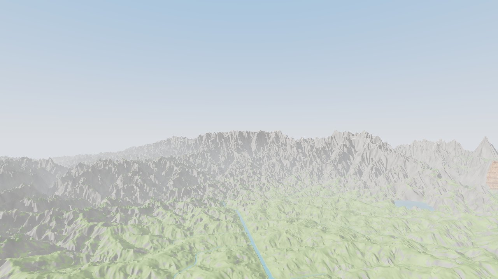

# VEYRATH — Unbound World

A fantasy game built on Minecraft Java Edition 26.3 (Fabric): a custom mod and a curated modpack.
Chapter 01 builds the world, a custom continental Overworld with monumental mountains, a
world-spanning rift, colossal forests, floating islands and drainage-following rivers.



*Preview render from the engine (not an in-game screenshot). More in [docs/media](docs/media).*

## Status

**Chapter 00 done on paper, Chapter 01 in progress.**
- The world engine works and is tested outside Minecraft.
- The Fabric mod, the Distant Horizons integration and the installer are written, but **have
  not yet run in Minecraft**.

Details: [docs/CHAPTER_STATUS.md](docs/CHAPTER_STATUS.md).

## Quick start

Requires JDK 25.

```
./gradlew :engine:test                                  # engine tests
./gradlew :preview:run --args="atlas --seed 1"          # continent maps -> preview-out/
./gradlew :preview:run --args="view --seed 1"           # landmark renders
./gradlew :mod-fabric:build                             # the mod (needs Fabric/Mojang/Modrinth access)
```

To play: build the mod, close the Minecraft Launcher, run `tools\install\Install-Veyrath.cmd`,
then start the **VEYRATH** profile. It uses its own game folder and leaves other profiles and
worlds alone. See [docs/TESTING_GUIDE.md](docs/TESTING_GUIDE.md).

## Documentation

| | |
|---|---|
| [Project vision](docs/PROJECT_VISION.md) | What VEYRATH is |
| [Chapter status](docs/CHAPTER_STATUS.md) | Where things stand, continuation summary |
| [Roadmap](docs/DEVELOPMENT_ROADMAP.md) · [Chapter 01 plan](docs/CHAPTER_01_PLAN.md) | What comes next |
| [Technical architecture](docs/TECHNICAL_ARCHITECTURE.md) · [Decisions](docs/TECHNICAL_DECISIONS.md) | How it is built and why |
| [World generation](docs/WORLD_GENERATION_DESIGN.md) · [Biomes](docs/BIOME_CATALOG.md) | The world |
| [Dependencies](docs/DEPENDENCIES.md) · [Asset licences](docs/ASSET_LICENSES.md) | What we use, and the rights |
| [Performance strategy](docs/PERFORMANCE_STRATEGY.md) · [Benchmarks](docs/PERFORMANCE_BENCHMARKS.md) | Targets and measurements |
| [Testing guide](docs/TESTING_GUIDE.md) · [Development environment](docs/DEVELOPMENT_ENVIRONMENT.md) | How to build and verify |
| [Asset pipeline](docs/ASSET_PIPELINE.md) | Textures, models, audio workflow |
| Research: [Minecraft version](docs/research/MINECRAFT_VERSION_COMPARISON.md) · [Modloader](docs/research/MODLOADER_COMPARISON.md) · [Rendering and shaders](docs/research/RENDERING_AND_SHADER_STRATEGY.md) | Chapter 00 research |
| [Changelog](CHANGELOG.md) | |

## Licence

No licence has been chosen yet. All rights reserved by the project owner.
