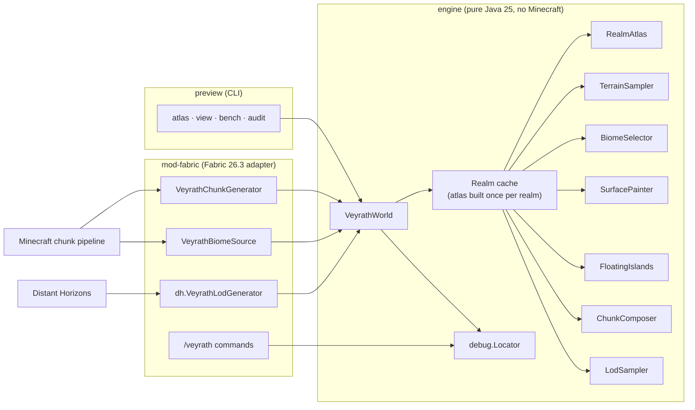

# Technical architecture

Last updated: 2026-11-02. This describes the code as it is. Parts not yet verified in Minecraft
are marked.

## Overview



The world is computed by the **engine**, a library with no Minecraft dependency. Minecraft
reaches it through a thin **adapter** (`mod-fabric`), and so do Distant Horizons and the
**preview** tool. Everything that decides what the world looks like can be tested,
benchmarked and rendered without starting the game (TD-003).

## Modules

| Module | Purpose | Depends on |
|---|---|---|
| `engine` | World generation core: atlas, terrain, biomes, materials, formations, chunk and LOD output | Java 25 only |
| `preview` | Command-line tool: atlas maps, perspective renders, benchmark, quality audit | `engine` |
| `mod-fabric` | Fabric mod: generator and biome source registration, biomes, world preset, dimension type, DH integration, debug commands, data generation | `engine` (bundled as jar-in-jar), Minecraft 26.3, Fabric API, DH API (compile only) |
| `tools/install` | Windows installer for the dedicated launcher profile | PowerShell 5.1+ |
| `modpack` | The modpack definition the installer reads | — |

### Engine packages

| Package | Contents |
|---|---|
| `dev.veyrath.engine` | `WorldSpec` (seed, heights, realm size), `VeyrathWorld` (entry point, realm cache, coordinates, spawn) |
| `atlas` | `AtlasBuilder` (macro pipeline), `RealmAtlas` (immutable result), `DrainageSolver`, `Province`, `Volcano`, `Polyline`, grid utilities |
| `hydro` | `RiverNetwork`: river polylines with width, water level and bed depth, plus a spatial index |
| `terrain` | `TerrainSampler`: exact ground and water surface per column. `ColumnInfo`: everything known about a column |
| `biome` | `VBiome` (26 biomes), `BiomeSelector` (rules) |
| `surface` | `Material` (engine block vocabulary), `SurfacePainter` (geology, soils, snow, fluids) |
| `formation` | `FloatingIslands`. Arches, overhangs, pillars and colossal trees are planned here |
| `chunk` | `ChunkComposer` and `ChunkBuffer`: one chunk of materials and biomes |
| `lod` | `LodSampler`: run-length column data at any detail level, for Distant Horizons |
| `math` | Simplex noise, fractal sums, domain warp, gully noise, hashing |
| `debug` | `Locator`: finds named places (spawn, rift, crown, throne, summit, one per archetype) |

### Adapter packages (`mod-fabric`, not yet compiled)

| Package | Contents |
|---|---|
| `dev.veyrath.mod` | `VeyrathMod` (registration, lifecycle, reflective DH start), `VeyrathRuntime` (engine instance per running server) |
| `gen` | `VeyrathChunkGenerator`, `VeyrathBiomeSource`, `VeyrathBiomes` (biome definitions), `MaterialPalette` (material to block) |
| `dh` | `DhIntegration` (registers per level), `VeyrathLodGenerator` (`IDhApiWorldGenerator`, `API_DATA_SOURCES`) |
| `debug` | `/veyrath info`, `/veyrath locate <target>`, `/veyrath tp <target>` |
| `data` | `VeyrathDataGen`: writes biome JSON from `VeyrathBiomes` |
| `client` | `VeyrathClient` (logging only so far) |

Resources:
- `world_preset/veyrath.json`: Overworld = VEYRATH generator, plus the vanilla Nether and End.
- `dimension_type/veyrath.json`: y −256..1023. **Its 26.3 format is unverified.**
- A tag adding the preset to the world-type list.

## Data flow

### Full-detail chunks

1. Minecraft calls `VeyrathChunkGenerator.fillFromNoise` for a chunk at the `NOISE` status.
2. The generator converts world chunk to engine chunk by adding the origin offset in chunks
   (TD-009).
3. `VeyrathWorld.composeWorldChunk` takes the realm from the cache, building it if this is the
   first request.
4. `ChunkComposer` samples 18 × 18 columns (one-block border for slopes) with `TerrainSampler`.
   It then chooses a biome per column, paints materials, and adds floating-island intervals.
5. The result is a `ChunkBuffer`: material ordinals for every column and y, plus surface biomes.
6. The generator writes block states section by section through `MaterialPalette` and primes
   the heightmaps.
7. `VeyrathBiomeSource` answers biome queries at quart resolution from the same `BiomeSelector`,
   so what F3 shows and what was painted agree.

### Distant terrain (Distant Horizons)

1. DH calls `VeyrathLodGenerator.generateLod(chunkPosMinX, chunkPosMinZ, …, detailLevel, …)`.
2. On DH's worker pool, `LodSampler` samples one column per `2^detail` blocks. It reuses
   `TerrainSampler`, `BiomeSelector`, `SurfacePainter` and `FloatingIslands`, and emits
   run-length segments: hidden rock, exposed layers, fluids, island runs, air.
3. Segments become `DhApiTerrainDataPoint`s with DH block and biome wrappers for the same
   blocks the palette uses. Sky light is 0, because DH lights LODs itself. Block light is 15
   for lava and 3 for magma.

Both paths share the same functions, so distant terrain cannot disagree with near terrain except
through sampling resolution. `WorldInvariantsTest.lodAtBlockDetailMatchesChunks` checks this.

## Coordinates

- **Engine coordinates.** Realm (rx, rz) is centred on (rx·32768, rz·32768).
- **World coordinates** (Minecraft). World (0, 0) is the curated spawn of realm (0, 0): the
  refined spawn rounded down to a chunk corner. The origin offset is computed lazily from realm
  (0, 0) and is always a multiple of 16.
- Methods that take world coordinates say so in their names: `sampleWorld`, `realmAtWorld`,
  `composeWorldChunk`.

## Threading and determinism

- `RealmAtlas`, `TerrainSampler`, `BiomeSelector`, `SurfacePainter` and `FloatingIslands` are
  immutable after construction. Per-thread scratch objects (`TerrainSampler.Scratch`,
  `ChunkComposer.Context`, `LodSampler.Context`) hold all mutable state.
- The realm cache builds each realm once. Concurrent requests wait for the same future.
  `VeyrathRuntime.start` prewarms realm (0, 0) on a background thread when the server starts.
- Every random choice comes from `Hash.derive(seed, "<purpose>")`, so a seed always produces the
  same world on any thread count. `DeterminismTest` checks same seed gives the same chunks, a
  different seed gives a different world, and parallel matches sequential.
- Atlas construction itself is parallel over rows (`GridOps.parallelRows`).

## Memory

The measured heap after GC is 356–444 MB with 4–5 realms built, about 90 MB per realm
([PERFORMANCE_BENCHMARKS.md](PERFORMANCE_BENCHMARKS.md)). Chunk composition allocates only
per-thread scratch. A realm stays cached for the lifetime of the server. Evicting realms far from
all players is a later optimisation, needed only if players roam across many realms.

## Height

The world spans y −256 to 1023 (1280 blocks, 80 sections) with sea level at 64 (TD-006). The
atlas applies a soft ceiling at `maxY − 200`, so the highest ground stays at or below y943. That
leaves room for trees and floating islands above.

## Extension points for later Chapters

These hooks exist now, or are designed and planned for Chapter 01. Nothing from later Chapters
is implemented.

| Future need | Hook |
|---|---|
| Structures, cities, dungeons (future) | `Locator` and the atlas know provinces, rivers, the rift, volcanoes and spawn. A structure planner can query `RealmAtlas` for sites (flat land near rivers, cliff faces) without generating chunks |
| Boss arenas (Chapter 04) | Formation systems can reserve terrain. Arenas can be planned at landmark sites (Cinder Throne crater, Crown of Aether) |
| Dragon flight (Chapter 05) | `VeyrathWorld.sampleWorld` gives ground height anywhere without loading chunks, which suits flight AI, camera collision at range and landing-site search |
| Custom blocks | `Material` to `MaterialPalette`. The engine never changes |
| New biomes | Add to `VBiome`, a rule in `BiomeSelector` and surface rules. The adapter's data generation writes the JSON |
| Points of interest and quests | `Locator` targets. Atlas `Province` records carry archetype and position |
| Multiplayer | Generation is server-side and deterministic (TD-012) |

## Repository layout

```
veyrath/
├── build.gradle.kts, settings.gradle.kts, gradle.properties
├── gradle/libs.versions.toml          all pinned versions
├── engine/                            world engine (pure Java)
│   └── src/main/java/dev/veyrath/engine/{atlas,hydro,terrain,biome,surface,formation,chunk,lod,math,debug}
│   └── src/test/java/...              determinism and invariant tests
├── preview/                           CLI: atlas | view | bench | audit
├── mod-fabric/                        Fabric adapter
│   ├── src/main/java/dev/veyrath/mod/{gen,dh,debug,data}
│   ├── src/client/java/dev/veyrath/mod/client
│   ├── src/main/resources/            fabric.mod.json, world preset, dimension type, lang, icon
│   └── src/main/generated/            data-generation output (committed)
├── modpack/modpack.json               player install definition
├── tools/install/                     Install-Veyrath.ps1 / .cmd, profile icon
└── docs/                              these documents, research/, media/
```

Planned additions:
- `assets/` for source art: Blockbench, Krita and Blender files. See [ASSET_PIPELINE.md](ASSET_PIPELINE.md).
- `mod-fabric/src/main/resources/assets/veyrath/{textures,models,blockstates}` for Phase B blocks.

## Save compatibility

The world is generated from code. Any change to generation changes chunks that are not yet
generated, so existing worlds would show seams at the border with old chunks. During Chapter 01,
test worlds are disposable. Before any world is meant to last, VEYRATH will record its
generator version in the world's level data and warn when an older world is opened with a
newer generator (planned in WP1).
