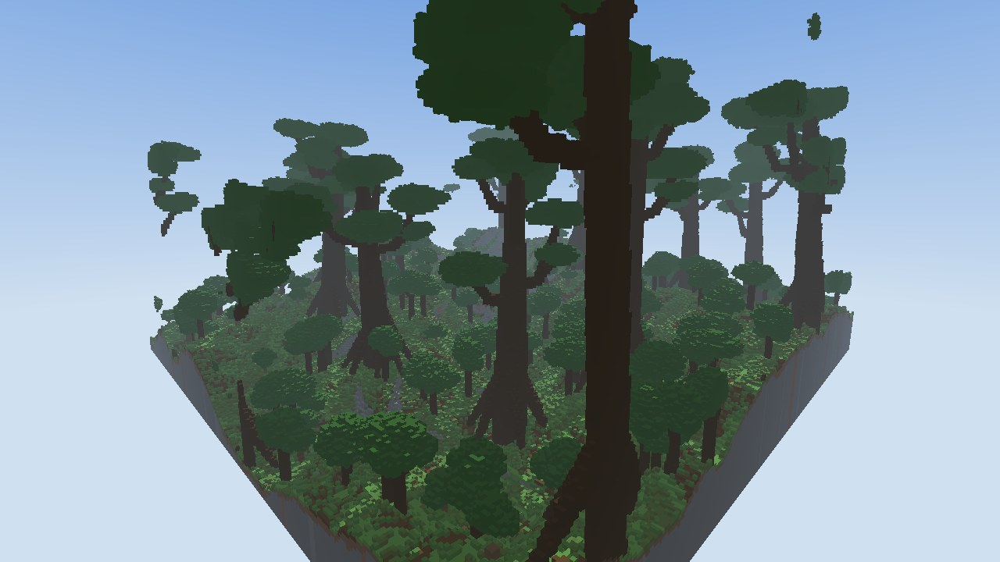

# World generation design

Last updated: 2026-11-02. Sections say whether a feature is **implemented** (in the engine,
tested outside Minecraft) or **planned** (Chapter 01 work packages in
[CHAPTER_01_PLAN.md](CHAPTER_01_PLAN.md)).

## Principles

1. **Designed geography, not noise.** Large-scale structure is decided first: continent, mountain
   belts, regions, the rift, drainage. Noise only adds detail. Rivers run where water would run.
2. **Coherent regions.** A province keeps one identity across kilometres. Biomes vary inside it
   by elevation, slope, water and patch noise, so there are no new biomes every few hundred blocks.
3. **Rarity creates impact.** World-tier landmarks occur once per continent, regional landmarks
   a few times, local formations often (see "Landmark tiers").
4. **One function, every distance.** Chunks, Distant Horizons LODs and the preview renderer call
   the same sampling code.
5. **Deterministic and parallel.** Every result depends only on the seed and the position.

## Scales

| Scale | Size | Decided by |
|---|---|---|
| Realm (one continent and its sea) | 32,768 × 32,768 blocks | `AtlasBuilder`, once per realm, about 10 s |
| Atlas cell | 32 × 32 blocks (1024² per realm) | Erosion, drainage, climate, archetype weights |
| Province | Several km across, about 40 per realm | Poisson-disk seeds, warped Voronoi cells |
| Archetype region | Contiguous groups of provinces, about 20–170 km² each (seeds 1–3) | Focus placement and region growth |
| Biome patch | Hundreds of metres to kilometres | `BiomeSelector` |
| Column | 1 × 1 block | `TerrainSampler`, `SurfacePainter` |

Measured continent statistics (seeds 1, 2, 3):
- Land: 454, 430 and 453 km².
- Lakes: 4.2, 9.0 and 4.0 km².
- Provinces: 40, 41 and 40.
- River reaches: 331, 310 and 307.

## Atlas pipeline (implemented)

1. **Continent.** A warped radial falloff plus fractal noise. The realm rim is always sea, so
   realms are independent (TD-007).
2. **Climate.** Distance to the coast, temperature (cold in the north) and moisture (driven by
   the coast).
3. **Mountain belts.** Long curved orogenic polylines with varying width and amplitude. Every
   archetype responds to them by its own factor (`beltResponse`).
4. **Provinces.** Poisson-disk seeds, warped Voronoi cells and an adjacency graph.
5. **Archetypes.** One focus per landscape pillar is placed by a suitability score with a
   minimum separation. For example:
   - Aethercrown on strong belts and cold ground.
   - Cinderwake warm and inland.
   - Gloamreed wet and near the coast.
   - Aetherreach about 8 km from the high peaks.
   - No pillar within 3.5 km of the realm centre, which stays gentle land for spawn.

   Each focus then grows a contiguous region over the province graph. Remaining provinces
   become Sunmantle Vales, the gentle connective land.
6. **The Great Rift.** A world-scale ravine path from deep inland to the sea through the
   Vesperfall region. Its floor descends from `sea + 127` inland to sea level, and erosion is not
   allowed to fill it.
7. **Erosion.** See below.
8. **Volcanoes.** Cones in the Cinderwake, laid over the eroded land as young landforms. One of
   them is the **Cinder Throne** supervolcano with a crater lava lake.
9. **Talus relaxation.** Limits slopes to stable angles and softens unrealistic spikes.
10. **Lakes.** Basins in valley floors behind natural dams. The surface sits at the exact spill
    level, so it is flat, and the outflow cascades back to the valley. Lakes smaller than 8 cells
    are removed.
11. **Hydrology.** A priority flood gives final water levels. Rivers are extracted from the
    drainage graph (see "Rivers").
12. **Spawn.** The atlas picks a cell of gentle Sunmantle land near y70 and near the realm
    centre, with a mountain belt in view about 4 km to the north. `VeyrathWorld.refineSpawn`
    then refines it at block level: dry, no lava, slope ≤ 0.3, at least 24 blocks beyond any
    river bank, and dry, level neighbours.

### Atlas erosion

An implicit stream-power solver (the classic fluvial landscape-evolution model) runs over the
atlas:

`h ← (h + U + f·h_receiver) / (1 + f)`, with `f = K·√(A − A_c) / Δx`

- `A` is the drainage area, accumulated with moisture-weighted precipitation.
- `A_c` is a per-archetype channel threshold. Plateau tops below it are not incised.
- `K` is per-archetype erodibility.
- `U` is the uplift or relief term. It is built from per-archetype `relief`, the mountain-belt
  load (`BELT_RELIEF = 40`), summit massifs and a low-frequency relief noise.
- The area exponent is `M_EXP = 0.5`.
- Base elevation is set before erosion. Each archetype adds `baseLift`: Vesperfall +400
  (plateaus), Aethercrown +160, Gloamreed +4. Belts add up to `BELT_LIFT = 460` inland.

The solve is **multi-resolution**: 70 iterations at 4× cells, 26 at 2×, then 12 at full
resolution. Coarse levels organise the drainage network cheaply. Each finer level inherits the
coarse level's *change* (delta upsampling), so fine initial detail survives.

**Summit massifs** are a few dominant summit groups in Aethercrown provinces. They give ranges a
hierarchy of peaks instead of uniform crests. The strongest is the **Crownspire**, in the
province with the highest belt load.

**Summit ceiling.** After talus relaxation, elevations above a knee at `maxY − 263` (y760) are
compressed with a square-root curve, `760 + 140·(√(1 + (h − 760)/70) − 1)`, which keeps summits
pointed instead of flattening them. A `tanh` guard above `maxY − 83` (y940) caps ground below
y980. Seeds 1–3 reach y934, y959 and y925 with no pile-up at the cap. `preview atlas` prints the
highest ground before the ceiling and how many cells it touched.

Cost: 6.8–7.2 s of the 9.5–10.3 s realm build on 4 cores.

### Rivers

- Rivers start where the drainage area crosses the channel threshold and follow the receiver
  graph to the sea or a lake.
- Polylines are smoothed (Chaikin). Each vertex carries width, water level and bed depth.
- **Water level never rises downstream.** This is enforced at extraction, then at confluences:
  a tributary's mouth level caps the main stem below it (`enforceConfluenceLevels`). Test:
  `riverLevelsNeverRiseDownstream`.
- `RiverNetwork` keeps a bucket index (256-block buckets) for nearest-river queries during
  chunk generation.

**Known issue:** 0.35–0.48 % of river water blocks and 0–0.49 % of lake water blocks have air
beside them (audit, seeds 1–3). Minecraft water there starts to flow on the first block update.
None have air below. WP2 removes these and adds real waterfalls where levels step down.

## Fine terrain (implemented)

`TerrainSampler` turns the atlas into an exact ground and water surface for each column. Steps,
in order:

1. **Atlas elevation**, bicubic.
2. **Gully detail.** Three octaves of slope-aligned gully noise (150, 64 and 28 blocks)
   follow the downslope direction. Gullies are rounded troughs and spurs are sharpened crests.
   The effect is strongest on rugged, steep ground and calm on lowlands and coasts.
3. **Ridged crests** on high Aethercrown ground.
4. **Strata terraces**: flat treads and steep risers, 16–26 blocks per step. Full strength in
   Vesperfall, partial in Cinderwake, Prismmere and Aethercrown, and only above `sea + 30`.
5. **Glacial troughs.** Large Aethercrown valleys get wide, flat floors and steep walls.
6. **River channels and banks**, from the atlas river network.
7. **The Great Rift.** Near-vertical layered walls down to the rift floor.
8. **Water.** Sea, lakes (atlas basins with a fine shoreline) and river surfaces. A river or lake
   keeps its own surface where its bed dips below sea level near the coast.
9. **Containment** (in `ChunkComposer` and `LodSampler`, from the raw samples): a dry column whose
   ground lies below a neighbour's top water or lava block is raised level with it, so no fluid
   has open air beside it.
10. **Rapids.** Water beside lower water (a step on a sloped river, 0.1–0.3 % of river water) is
   listed in `ChunkBuffer.flow`; the adapter marks those blocks for post-processing, so
   Minecraft ticks them once and they flow down as small rapids.
11. **Waterfalls.** `AtlasBuilder.terraceFalls` turns steep reaches into pools and falls: walking
   upstream from the mouth, the level stays flat until the smooth profile is a fall height above
   it (0 on gentle reaches, up to 34 blocks on the steepest), then steps up. Levels only drop, so
   gorges are carved, never built up; tributaries start from the main river's terraced level.
   `RiverNetwork.nearest` puts the step at the segment midpoint, so the bank terrain forms a cliff
   across the valley and the lip water is listed for a fluid tick (step 10), which makes it pour
   down. Seed 1 has 462 falls in the spawn realm, 101 of them 20 blocks or taller. A river or
   lake that the Rift cuts from under itself is cut off at the lip (`ColumnInfo.fall`) and pours
   into the Rift instead of hanging there as a block of water.

## Formations

| Formation | State | Notes |
|---|---|---|
| The Great Rift | Implemented | One per realm, world-tier. Layered walls. `/veyrath tp rift`, `rift_rim` |
| Glacial troughs | Implemented | Aethercrown valleys |
| Volcanoes and the Cinder Throne | Implemented | Lava lakes. `/veyrath tp throne` |
| Crownspire massif | Implemented | Highest summit group. `/veyrath tp summit` |
| Floating islands | Implemented | See below |
| Giant arches | In engine (`formation/Arches`) | One candidate per 900-block cell: Vesperfall 70 %, Cinderwake 30 %, Aethercrown 20 % (27 arches on seed 1). Span 70–170, rise 0.38–0.63 of the span above the higher foot, band 7–15 thick and 10–22 wide, legs flared, apex off-centre, thickness varying along the band. Both feet dry, 20+ blocks from rivers, similar ground. Rock and beds from `SurfacePainter.rockAt`. In chunks and LOD. `/veyrath tp arch` |
| Rock bridges, overhangs | Planned (WP5) | Need 3D volumes |
| Pillars and spires | Planned (WP5) | Column-separable, cheap |
| The Prism Caldera | In engine (`terrain/PrismCaldera`) | One per realm on the most even dry Prismmere ground far from rivers, lakes, the Rift, volcanoes and the coast (the whole disk is checked on a 32-block grid). Crater lake of radius 130–270 (233 on seed 1, 239 on seeds 2 and 3), terraced inner cliffs about 80 blocks high, an outer flank with radial gullies, a flat-topped island. About 60 hexagonal amethyst and quartz crystals: a 100-block centrepiece on the island, clusters on the rim, spires rising from the water. The ring between lake and flank is at least one block above the lake everywhere, so the lake is closed by construction (audit `caldera`). Part of the heightfield, so chunks, LOD, caves and trees handle it. `/veyrath tp caldera` |
| The Elder Tree | In engine (`Vegetation.elderTree`) | One per realm: `TreeKind.ELDER_TREE` (290–330 tall, trunk 15–18, crown 95–112, 9–12 limbs) on the first Elderbough province site that is dry, level within 34 blocks and 70+ blocks from rivers. Giants keep 150 blocks away. Drawn into chunks like any giant and added to LOD columns at every detail level |
| Caves and cave entrances | Phase A in engine (`cave/Caves`) | Winding tunnels (two 3D fields near zero) and caverns (a third field high) on a 4 x 8 x 4 lattice, within 160 blocks below the surface; lava below y −232. A 6-block crust under the lowest neighbouring ground (14 beside water) keeps every river, lake and sea sealed (audit: 0 leaks). Funnel-shaped mouths up to 40 deep open on hillsides away from water; trees keep off them. About 5–10 % air at 20–160 blocks deep. Not in LOD. Chunk cost +0.3 ms |
| Waterfalls (river steps, lake outlets, island falls) | River steps and Rift lips in engine | See step 11. Lake outlets and island falls planned |
| Colossal trees | Elderbough giants and the Elder Tree in engine | See `vegetation/` |

### Floating islands (implemented)

- Islands are placed on a jittered 384-block grid.
- Probability per cell is `0.010 + 0.55·w_Aetherreach + 0.06·w_Aethercrown`, so they are common
  in the Aetherreach, occasional over high mountains and rare "wanderers" elsewhere.
- Radius 28–175 blocks, power-law distributed (many small, few large).
- Clearance above the ground below is 110–340 blocks plus 0.8 × radius. Islands that would come
  within 30 blocks of the terrain are dropped.
- Shape: a domed top with a soil cap over a ragged inverted rock cone (the torn-away root).
- **Crown of Aether**: one world-tier island per realm over the Aetherreach focus. Radius 330,
  360 blocks above the ground, with a 300-block root.
- Each island is column-separable (one solid interval per column), so it maps directly onto
  sections and DH column data.

Not yet: vegetation on islands, waterfalls falling from islands, satellite clusters.

## Biomes and surface (implemented)

There are 26 biomes in 8 archetype families plus sea and coast. Each is listed with its rules,
materials and planned vegetation in [BIOME_CATALOG.md](BIOME_CATALOG.md).

Geology is regional:
- Red and orange strata in the Vesperfall.
- Basalt, blackstone and obsidian in the Cinderwake.
- Calcite, crystal stone and amethyst in the Prismmere.
- Andesite and diorite in the Aethercrown.
- Deepslate and tuff below y0 and y−64.

The snow line is `sea + 560 − 320·(0.5 − temperature)` and the tree line 150 blocks below it.
High lakes freeze.

## Vertical layout

| y | Content |
|---|---|
| −256 | Bedrock floor (a few noisy layers) |
| −256 … −64 | Deep rock (deepslate, tuff). Planned deep cave layer |
| −64 … 0 | Transition to province rock |
| 64 | Sea level |
| 60–200 | Lowlands, vales, forests, fens, coasts |
| 200–600 | Highlands, Vesperfall plateaus (y510–590), Cinderwake volcano flanks (up to y650) |
| 600–980 | Aethercrown summits (Crownspire massif highest, y925–959 on seeds 1–3) |
| about 190–950 | Floating islands (110–480 blocks above the ground, capped at `maxY − 70`) |
| 1023 | Build limit |

## Distant Horizons LOD

**Implemented in the engine and tested. The adapter is written but not compiled or run.**

These facts were read from the Distant Horizons source (tag 3.3.4, API 7.2.0):

- `IDhApiWorldGenerator.getReturnType()` returns `API_DATA_SOURCES`, and DH then calls
  `generateLod(chunkPosMinX, chunkPosMinZ, lodPosX, lodPosZ, detailLevel, pooledFullDataSource,
  generatorMode, executor, resultConsumer)`.
- Columns are filled with `setApiDataPointColumn(x, z, EDhApiWorldGenerationStep.TERRAIN,
  points)`. Each data point has detail level 0, Y values relative to the level's minimum y, and
  a block and biome wrapper.
- Columns must be contiguous from the bottom to the top. The topmost segment is air, with sky
  light 0, because DH computes LOD lighting itself.
- Registration: `DhApiEventRegister.on(DhApiLevelLoadEvent.class, …)`, then
  `DhApi.worldGenOverrides.registerWorldGeneratorOverride(level, generator)`.
- `runApiValidation()` makes DH check the returned data. VEYRATH enables it by default during
  development (system property `veyrath.dh.validate`).

`LodSampler` produces, per column:
- One hidden rock run.
- The exposed range as material runs. "Exposed" goes down to two blocks below the lowest
  neighbour, so cliff faces show their strata.
- Fluid runs, island runs, and an air run to the top.

At coarse detail, short runs are merged to stay under DH's per-column budget. Tests:
- `lodColumnsCoverTheWholeHeightContiguously` (steps 1, 4, 32 and 256).
- `lodAtBlockDetailMatchesChunks`.

**Known issue:** a detail-8 section (16 km wide) near a realm edge touches neighbouring realms,
and the first touch blocks for about 10 s per unbuilt realm (bench maximum 16.8–18.5 s). WP8 adds
neighbour prewarming and a coarse fallback so DH is never blocked.

## True 3D geography (planned, WP5)

The terrain sampler is a height field plus intervals: ground, water and island intervals. That
is fast and maps cleanly onto LOD columns, but cannot express overhangs, arches or caves. The
plan is to keep the height field as the base and add **formation volumes**: bounded 3D shapes
placed by rules on specific sites.

- **Arches and rock bridges.** Spanning shapes between two high points across a gap, such as a
  river gorge or a rift branch, built from signed-distance segments with noise. Placed where the
  atlas shows a narrow gap between two high points.
- **Overhangs and cave mouths.** Subtractive volumes on steep faces (slope above a threshold),
  facing outward along the slope.
- **Caves.** Worm tunnels and chambers in the deep layer, with entrances only where a cave
  volume meets a cliff or valley floor. Underground water follows the hydrology.

Each volume has a bounding box, so a chunk evaluates only the volumes that overlap it. LOD
columns stay correct because a column can carry several runs. Openings in arches and overhangs
become air runs, and caves, which are invisible from afar, are skipped below the exposed range.

## Vegetation (implemented, phase A of WP4)

Code: `engine/.../vegetation/` (`Vegetation`, `Tree`, `TreeKind`). No vanilla features are used.

- **Placement.** Three jittered grids: giants (64-block cells), trees (8) and sparse trees (24).
  A cell holds at most one candidate. Whether it grows, and as what, depends on the biome, slope
  (measured over 2 blocks), water, volcanoes and the tree line at the candidate's own column.
  Alpine highlands have a tree line 150 blocks below the snow line; elsewhere only snow stops
  trees. Groves and clearings come from patch noise. Smaller trees keep clear of giant trunks.
- **Kinds.** Elderbough giants (72–128 blocks, buttress roots, curved great limbs, layered leaf
  clusters), elders, broadleaf, bloom (tinted foliage), storm pines (wind-leaning), pines,
  emberleaf (flat crowns), charred trunks and fen trees on stilt roots. Leaf colour comes from
  the biome foliage colour, so the same leaves read red on Vesperfall ledges and violet in
  Prismmere.
- **Seams.** A tree is built from primitives (tapered wood segments, leaf ellipsoids) whose
  tests depend only on world position. Every chunk it reaches draws its own part, and
  `VegetationTest` checks that all those chunks find the same trees.
- **Plants.** Grass, ferns, flowers in drifts, moss carpets and dry shrubs, one block tall, only
  on ground Minecraft accepts for them.
- **LOD.** Exact trees at 1–2 blocks per column, exact giants up to 16, and a canopy estimate
  (leaf runs at the species' crown height) further out.
- **Cost.** 1.0 ms per chunk in the Elderwood giant forest and 1.27 ms around spawn on the cloud
  machine (was 0.99 ms there without vegetation).

*Engine render of generated chunks (`preview voxel`), not an in-game screenshot.*

Not yet: island vegetation, hanging vines and roots, tall grass and reeds, crystal and fungal
flora, custom textures (phase B).

## Landmark tiers (planned, WP6)

The directive's four levels of significance:

| Tier | Frequency | Examples (implemented ✓, planned ○) |
|---|---|---|
| 4. World landmarks | One per realm | ✓ Great Rift, ✓ Crown of Aether, ✓ Cinder Throne, ✓ Crownspire, ✓ Elder Tree (colossal tree in the Elderbough), ✓ Prism Caldera (crystal crater lake) |
| 3. Regional landmarks | A few per archetype region | ✓ Waterfalls on river steps, ✓ giant arches, ○ hanging valleys |
| 2. Local formations | Often | ○ Pillars, ○ small arches, ○ boulder fields, ○ crystal outcrops along faults |
| 1. Ordinary beautiful terrain | Everywhere | ✓ Eroded relief, valleys and rivers |

Placement uses atlas knowledge, for example "a waterfall where a river drops more than 40 blocks
within 100 blocks", rather than random scattering. Each landmark registers with `Locator` so
`/veyrath tp` can reach it.

## Evaluation tools (implemented)

- `preview atlas`: relief and region maps per seed.
- `preview view`: perspective renders from landmark viewpoints.
- `preview audit`: unstable water and lava, and wet share and ground range per archetype.
- `preview bench`: engine performance.
- In game (written, not run): `/veyrath info`, `/veyrath locate <target>`, `/veyrath tp <target>`.
